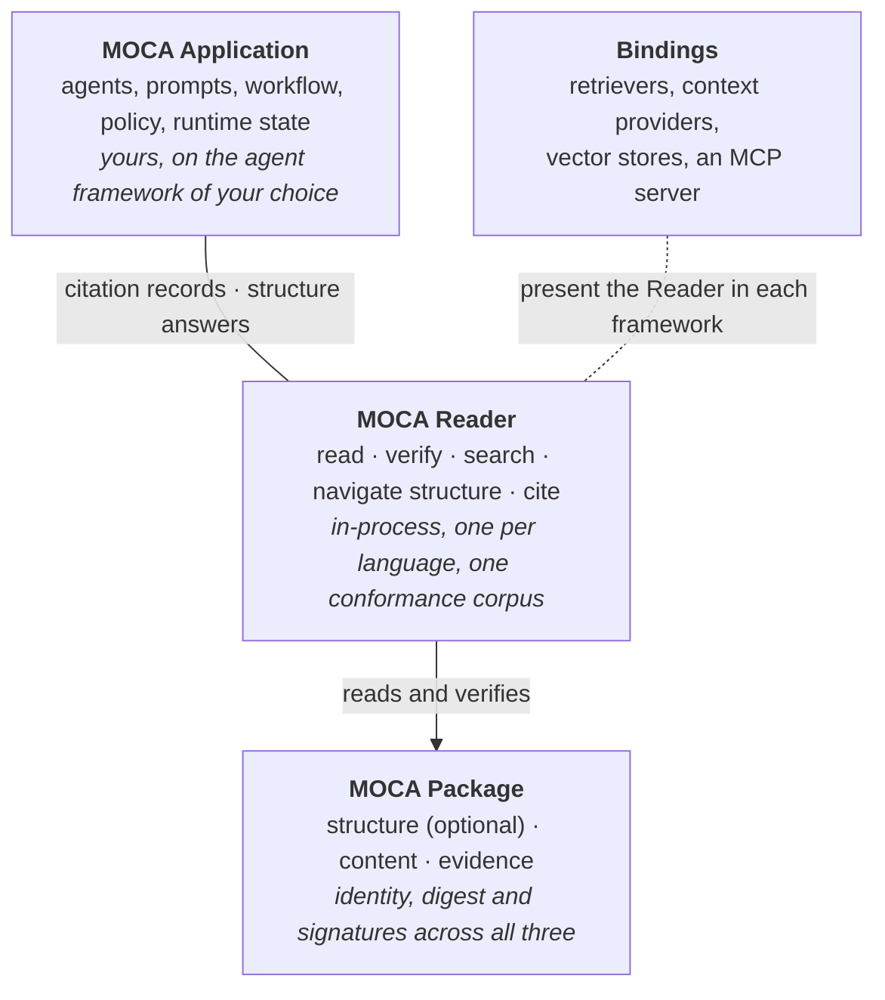
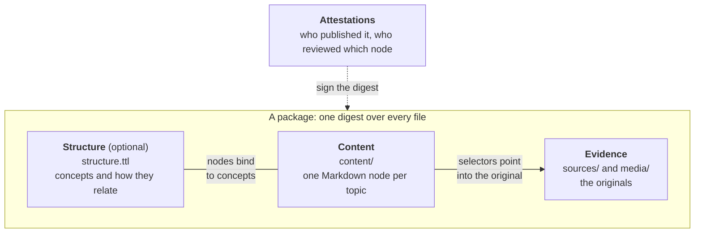
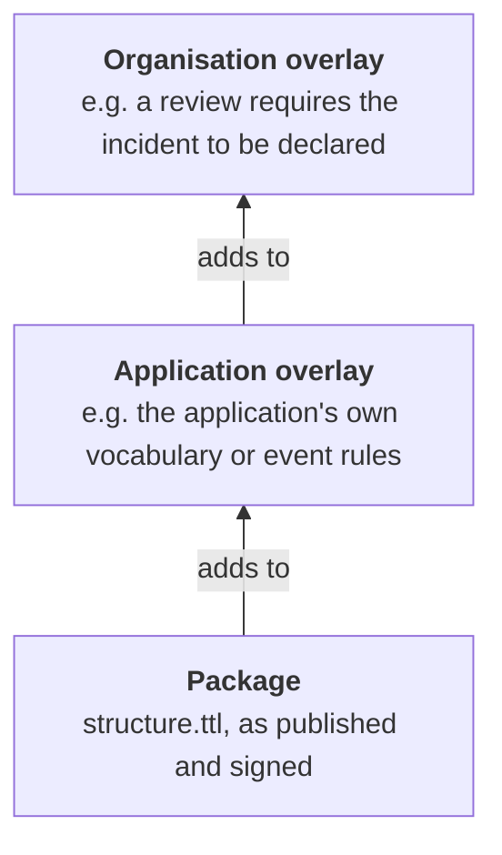
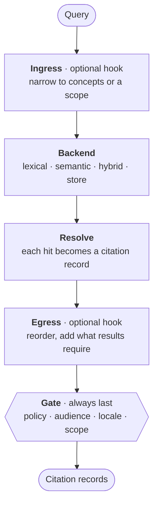
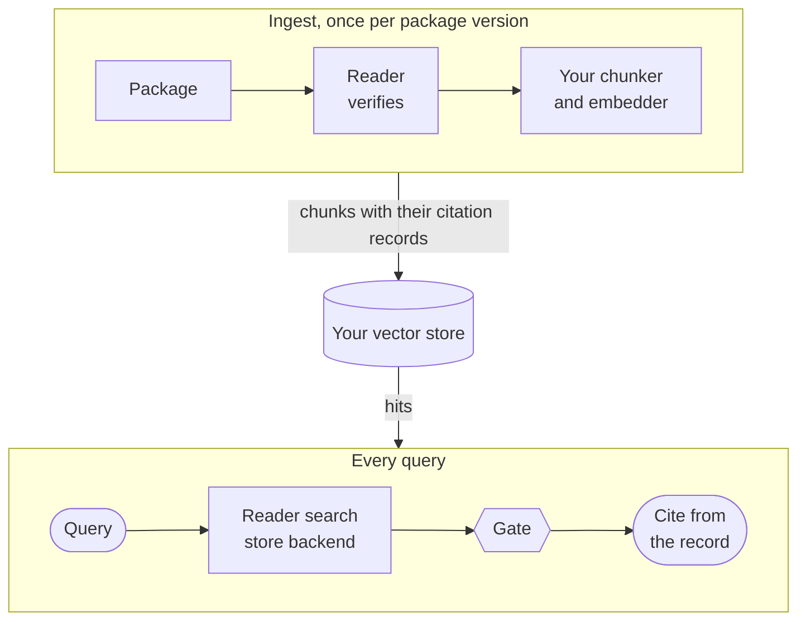

# Architecture

MOCA has three pillars
([ADR-0001](adr/0001-three-pillars-and-admission-test.md)):

The host that runs the Reader decides:

- what to trust (the trust root);
- where to find members (the resolver);
- who may see what (the audience set);
- which search backend and embedder to use;
- which overlays and retrieval hooks to load.

A package never decides any of these.

MOCA serves two purposes:

1. **Moving knowledge between platforms securely and verifiably.** The
   package serves this.
2. **Reading and integrating packages locally**, on edge devices or on
   infrastructure a client owns. The Reader serves this.

## The package

A package is a directory, a `.moca` archive or a host-supplied source. It
has three layers:

| Layer | Files | What it holds |
| --- | --- | --- |
| Structure (optional) | `structure.ttl` | Concepts, hierarchy, parts, order, `requires`, `replaces` |
| Content | `content/`, an OKF bundle | The knowledge, one node per topic, bound to concepts with `moca.concepts` |
| Evidence | `sources/`, `media/` | The originals, pointed into by W3C selectors |

The digest is the SHA-256 of a BagIt-style manifest of every file, so the
three layers travel together and arrive unchanged. Signed attestations under
`attestations/` sit outside the digest. They say who published the package,
and who reviewed which node.

A package is data. Loading it never runs anything, and nothing in it can
configure the Reader. See the
[package specification](../spec/moca-package-spec.md).

**Sidecar indexes sit beside a package, never inside it.** A sidecar holds the
package's text in passages, and optionally a vector for each, built with
`moca-index` for one package version and bound to its digest. It is derived
and disposable: change the package and the sidecar is stale, and the Reader
searches the package directly
([sidecar index spec](../spec/moca-sidecar-index-spec.md),
[search and sidecar indexes](guides/search-and-indexes.md)).

## Layers at load time

An application and an organisation can add to a package's structure without
changing it
([ADR-0008](adr/0008-package-application-organisation-layers.md)):

The host loads overlays. Only the package layer is digested and signed, and
every structure answer names the layer that stated it.

## The Reader

A Reader turns a package into conclusions that any implementation must agree
on:

- whether it is valid, and its digest and capabilities;
- which attestations verify;
- which members match their pins;
- whether each quoted passage matches its source;
- a citation record per node, with a versioned node reference;
- the answers to structure operations.

The [Reader contract](../spec/moca-reader-contract.md) is normative. The
[Reader interface](../spec/moca-reader-interface.md) names the same
operations for every language. The [conformance corpus](../conformance/README.md)
checks them.

| Language | Reader | Status |
| --- | --- | --- |
| TypeScript | [`@openmoca/moca-core`](https://github.com/openmoca/moca-reader-typescript#readme) | The reference Reader. |
| .NET | [`OpenMoca.Reader`](https://github.com/openmoca/moca-reader-dotnet#readme) | Passes the corpus and ranks as the reference Reader does. Bindings for Microsoft.Extensions.AI, the Microsoft Agent Framework and Microsoft.Extensions.VectorData. |
| Python | [`moca-reader`](https://github.com/openmoca/moca-reader-python#readme) | Passes the corpus and ranks as the reference Reader does. Retrievers for LangChain and LlamaIndex. |

### Search

Search is one operation over a backend the host chooses:

| Backend | Searches | Needs |
| --- | --- | --- |
| Lexical (keyword, BM25) | The package's own text, or a sidecar's chunks | Nothing. Works offline. |
| Semantic (dense) | A sidecar's binary vectors | A host embedder for the same model |
| Hybrid | Both, with the two ranked lists merged | Both of the above |
| Store | The host's own vector store | A binding that stores whole citation records at ingest |

Every search runs the same pipeline, whatever the backend:

The gate removes content from packages that are not loaded, content that is
out of force, superseded or deprecated, content outside the host's audience
set, and content outside the caller's locale, concepts or scope. Whatever a
backend or a hook did, nothing the policy excludes is returned.

### Ontology-guided retrieval

Structure facts are normative; how an application uses them to retrieve is
not ([ADR-0010](adr/0010-pluggable-ontology-guided-retrieval.md)):

- **ingress** maps a question onto concepts, and narrows what is searched. It
  can never widen what the caller asked for: the gate follows the caller;
- **egress** walks the results through the structure, for example adding the
  step that a procedure requires first.

Every Reader ships a default strategy. A domain extension, such as a legal,
procedures or course extension, supplies its own hooks and an overlay
vocabulary, on the same Reader.

## Bindings

A binding presents citation records in a framework's own types. It is thin:
it wraps the framework's abstractions, and never changes what a citation
record says.

| Framework | Language | Binding |
| --- | --- | --- |
| LangChain | Python | `moca-reader-langchain`: a retriever, with citation records as Documents |
| LlamaIndex | Python | `moca-reader-llamaindex`: a retriever, with citation records as scored nodes |
| Microsoft Agent Framework | .NET | `OpenMoca.Reader.AgentFramework`: a context provider, and search, node and structure tools |
| Microsoft.Extensions.AI | .NET | `OpenMoca.Reader.Extensions.AI`: any embedding generator as the Reader's embedder |
| Microsoft.Extensions.VectorData | .NET | `OpenMoca.Reader.VectorData`: search through any vector store, as a store backend |
| Model Context Protocol | Any MCP client | The MCP server, [`moca-mcp`](https://github.com/openmoca/moca-mcp-dotnet#readme), one download: tools for search and structure, and nodes as resources |

## How it fits a production retrieval stack

For retrieval-augmented generation (RAG) at scale, MOCA grounds your own
vector store: packages are verified at ingest, and the Reader applies the same
trust rules to every hit ([MOCA and RAG](moca-and-rag.md)).

- **Ingest:** verify the package once, then write each chunk to the store with
  its whole citation record, including the package digest.
- **Query:** search through the store backend. The Reader resolves hits from
  the stored records, recomputes freshness and validity, and keeps only
  packages the host has loaded, so it never needs every package in memory.
- **Answer:** cite `node.ref`, the version and the evidence, and show whether
  the evidence matched the original.
- **Update:** when a package's digest changes, re-ingest only the files whose
  SHA-256 changed. Records from the old digest stop being returned as soon as
  it leaves the allowlist.

## The application

Your product decides what the signals mean for its users. It might refuse
stale answers, warn on contested content, or prefer attested reviews. It
decides whether a person may move on to content that requires something they
have not done. It keeps that state, and any reporting, itself. MOCA makes the
signals and the structure reliable and portable; policy and state belong to
you.
