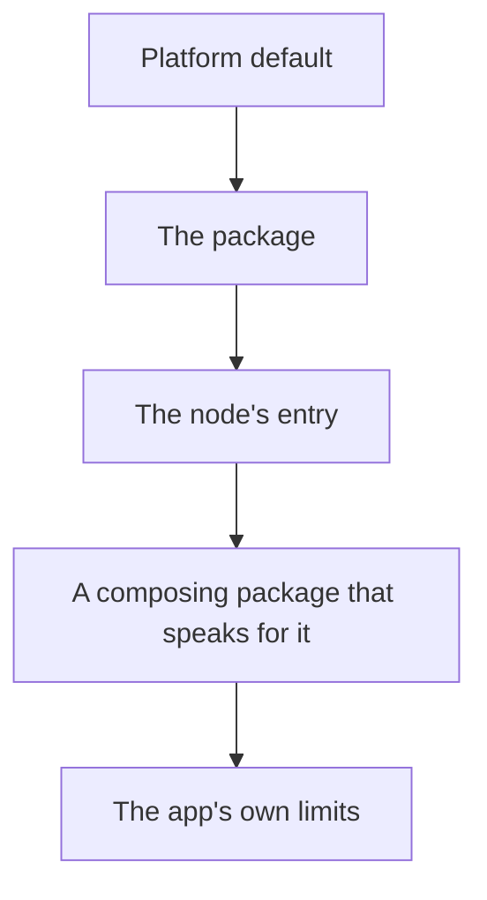

# The creator's terms

A creator can say, with the work itself, what may be done with it: which AI
use is acceptable, how suitable the work is, and who holds the rights. In a
MOCA package that is the `terms` block in `moca.json`
([package spec §4.14](../../spec/moca-package-spec.md#414-terms)). It travels
inside every copy of the package, it is covered by the digest, and a signature
shows who stated it.

Terms are **labels, not locks**. A Reader exposes them and, when an app asks,
leaves out what they exclude. An app that has opened a package can still
ignore them ([package spec §13.7](../../spec/moca-package-spec.md#137-terms-are-labels-not-locks)).
Apps that honour them can say so publicly, with the
[OpenMOCA Commitment](../../COMMITMENT.md).

This guide is for the people who make packages. If you build an app that
reads them, see [showing terms honestly](showing-terms.md).

## An example

A podcast episode that may be answered from on the person's device and in the
app's own service, but not sent to other companies' models, not machine
translated, and not exported as text:

```json
"terms": {
  "ai": {
    "allowed": { "provider": false, "machineTranslation": false }
  },
  "rating": { "explicit": false, "typicalAgeRange": "12-" },
  "rights": {
    "rightsHolder": { "id": "https://podcast.example.org", "name": "Example Podcast" },
    "basis": "own",
    "contact": "mailto:rights@example.org",
    "export": { "allowed": false },
    "copyright": { "year": "2024-2026", "notice": "© 2024-2026 Example Podcast Ltd" },
    "notice": "Listen and ask as much as you like. Please don't copy the transcripts elsewhere."
  }
}
```

Every field is optional. A field you leave out is **not set**, and the
platform default applies (below).

## What you can say

### AI use: `ai`

| Field | Says |
| --- | --- |
| `ai.allowed.device` | Whether AI on the person's own device may use the work |
| `ai.allowed.host` | Whether the app's own AI service may use it |
| `ai.allowed.provider` | Whether a third party's model may use it |
| `ai.allowed.training` | Whether the work may be used to train a model |
| `ai.allowed.machineTranslation` | Whether a machine may translate it. The package's own translations are not machine translation |
| `ai.allowed.mention` | Whether a model that may not receive this work may be told the work exists. Only for the whole package |
| `ai.providerRequires` | Conditions a third-party provider must meet: `noTraining`, `noRetention` |
| `ai.answerSources` | `work` (every sentence of an answer backed by the work) or `model` (the model's general knowledge allowed, and marked) |

The permissions are booleans: `true` or `false`, or left out.

**What `mention: false` does, and what it cannot do.** When you close your
work to a destination, an honest app may still tell that model your work's
title and publisher, so it can explain to the person why it cannot answer
from it. Set `"mention": false` when the title itself should not reach a
model your work is closed to: an app that honours your terms then tells that
model nothing about the work, not even that it exists. It does nothing while
the model is allowed to read the work, and it never changes what an app shows
people on its own screens. It cannot stop a model that already knows your
work from elsewhere, and it cannot bind an app that ignores terms. It applies
to the whole package; you cannot set it for one part. A value that is not
`true` or `false`, or an `allowed` that is not an object, hides the package
too, as everything malformed fails closed.

### Rating: `rating`

| Field | Says |
| --- | --- |
| `rating.explicit` | Whether the work is explicit, as `itunes:explicit` |
| `rating.contentRating` | A rating in a named scheme, such as a film board's |
| `rating.typicalAgeRange` | Who the work is meant for, such as `12-` or `7-11`, as schema.org. It describes; it never removes anything |
| `rating.declaredBy` | `signer` (you state it) or `feed` (taken from the source's metadata) |

Ratings describe the work. They are not permissions: an app filters on them
if it chooses to.

### Rights: `rights`

| Field | Says |
| --- | --- |
| `rights.rightsHolder` | Who holds the rights: the `https:` site or feed where they publish, and a name |
| `rights.basis` | `own` (the rights holder made the package), `consent` (made with their consent) or `license` (made under the open licence in the manifest's `license`) |
| `rights.contact` | Where people can report a problem or claim the work |
| `rights.repackage.allowed` | Whether others may repackage the work, as `podcast:locked`; `packagers` names who may anyway |
| `rights.export.allowed` | Whether an app may let people copy, save or export the work's text outside the app. Quoting it in an answer, playing a moment and reading it in the app are not export |
| `rights.copyright` | The copyright `year`, `holder` and the exact `notice` to show, as schema.org |
| `rights.notice` | A short message from you, in your own words, for an app to show beside the work. It grants and restricts nothing |

### Parts of the work: `nodes`

Some parts may need different terms: an episode rated explicit in a clean
show, a photo under someone else's licence, a chapter that may not go to
other companies' models. Give them in `terms.nodes`, by path or by folder:

```json
"nodes": [
  { "paths": ["content/episodes/12/"], "rating": { "explicit": true } },
  { "paths": ["content/photos/studio.md"],
    "rights": { "license": "CC-BY-4.0", "copyright": { "holder": { "name": "A. Photographer" } } } }
]
```

- The entry with the longest matching path applies. A node with no entry has
  the package's values.
- A node's `ai` values may only make a permission stricter. A looser one is
  reported (`U002_TERMS_LOOSENED`) and the package's value stands.
- A node's `rating` is its own, and may be less strict than the package's.
- A node's `rights` hold only `license` and `copyright`: the licence and
  copyright of that part, for display and citation. They never change a
  permission.
- Terms live only in the manifest. A `moca.*` key in a node's frontmatter
  that looks like a term has no effect.

## How terms resolve

When an app asks, the Reader works out each permission for each node
([Reader contract §15.3](../../spec/moca-reader-contract.md#153-resolving-terms)).
It starts from the platform default, then each level may only make it
stricter:



- **Platform defaults**, used when no level sets a field: AI on the device,
  in the app's own service and with providers allowed; machine translation
  allowed; a closed work may be mentioned; export allowed; **training not
  allowed**; no provider conditions; `answerSources` `model`.
- **Stricter wins.** `false` is stricter than `true`; more provider conditions
  are stricter; `work` is stricter than `model`. A malformed or unknown value
  counts as the strictest.
- **Not set never changes anything.** A field left out keeps what the level
  before it said.
- **The record says who decided.** Each resolved field names the level that
  decided it: `platform`, `package`, `node`, `composite` or `host`.

Export resolves the same way, from the package and a composing package that
speaks for it.

### Who decides

**In 0.7.0, a package can only make terms stricter.** Whoever signed it, a
package cannot loosen the platform defaults: `ai.allowed.training: true` has
no effect, because training is not allowed by default. So in this version,
terms are what you **rule out**: third-party providers, machine translation,
export, and AI use altogether.

A signature shows who signed the package, not who owns the work. A Reader
gives the terms an **authority** from the package's signatures alone:
`packager` when a package attestation verifies under the app's trust root,
`unverified` when none does
([Reader contract §15.2](../../spec/moca-reader-contract.md#152-authority)).
`rightsHolder` and `basis` are the signer's claims.

Letting the rights holder loosen the defaults, with keys found on their own
channel, comes in a later version
([ADR-0036](../adr/0036-creators-terms-travel-with-the-work.md)).

## What the app does with them

- A Reader **exposes** your terms exactly as written, with any problems and
  the authority. It fills in no defaults.
- An app that is about to hand content to a model, or to show or play it
  under a rating filter, **asks the Reader to apply them**. The search then
  leaves out what the terms exclude for that destination and use, and counts
  what it left out
  ([Reader contract §15.4](../../spec/moca-reader-contract.md#154-the-terms-gate)).
  The same applies to everything else a model receives: text sent to be
  embedded, your topic labels and definitions, and what the model is told
  about your package.
- Without that request, terms remove nothing.
- Terms are never configuration and never instructions to a model. Naming a
  destination never makes an app use it, and text in the content that claims
  a permission has no effect.

## Beside what you already use

You may already state AI preferences where crawlers look: the TDM Reservation
Protocol (TDMRep), the IETF AI preferences vocabulary, or RSL. Those statements
stay on your site. `terms` keeps them **with the work**, in every copy.

You may publish the same terms in both places, and read those statements into
a package, but only to make terms stricter. Where a term cannot be expressed,
map to the stricter one. For example, TDMRep's `tdm-reservation: 1` becomes
`ai.allowed.training: false`. The full mapping is in
[package spec §4.14](../../spec/moca-package-spec.md#414-terms), "Other
standards".

Podcast feeds map too: `itunes:explicit` to `rating.explicit` (with
`declaredBy: feed`), and `podcast:locked` to `rights.repackage.allowed: false`.

## Changing your terms

Terms are covered by the digest, so changing them makes a new version of the
package. A terms change is at least a minor version
([package spec §4.3](../../spec/moca-package-spec.md#43-content-versions)).
Copies already made keep the terms they were made with.

## What terms do not do

- They do not stop an app that ignores them. Choose, and point people to,
  apps that make the OpenMOCA Commitment.
- Encryption limits who can open a package; it cannot make an app that opened
  it keep the terms ([protected sources](protected-sources.md)).
- Stripping `terms` from a copy and signing it again leaves a package with no
  terms and a different signer. Only an app that checks who signed can tell.
- The absence of terms or a rating proves nothing.

## Next

- [Credits and dates](credits-and-dates.md): who made the work, and when.
- [Machine-made content](machine-made.md): marking what a machine made.
- [Protected sources](protected-sources.md): sealed packages and reference
  nodes.
- [Showing terms honestly](showing-terms.md): for app builders.
- [Package spec §4.14](../../spec/moca-package-spec.md#414-terms) and
  [Reader contract §15](../../spec/moca-reader-contract.md#15-creators-terms):
  the rules.
