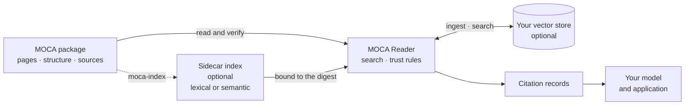

# MOCA and RAG

Retrieval-augmented generation (RAG) grounds a model's answer in content
retrieved for the question. Most RAG pipelines start by flattening knowledge
into chunks in a vector store. On the way, the knowledge loses what made it
trustworthy: which version it was, who published it, whether it is still in
force, who it was for, how it was organised, and the source each statement
came from.

**MOCA keeps those things with the knowledge, so RAG can use them.** A MOCA
package is the knowledge a RAG pipeline retrieves from, with its version, its
structure and its original sources, sealed by one digest. A MOCA Reader does
the retrieval, or sits in front of your own vector store, and every result
comes back as a citation that can be checked.

## What changes in a RAG pipeline

| RAG problem | Without MOCA | With MOCA |
| --- | --- | --- |
| **Citations nobody can check** | The answer names a document, if anything | Every result is a citation record: the passage, a versioned reference to the page, and the quote it relies on, marked `matched` when found in the original inside the package |
| **Stale or superseded content** | Old chunks stay in the index until someone rebuilds it | Pages and packages carry validity dates, and a newer package can supersede an older one; the Reader leaves out content that is not in force or has been replaced, at search time |
| **Content for the wrong audience** | Internal pages leak into public answers unless every pipeline filters them | Each page has an audience; the host's audience filter runs on every search, and a caller cannot widen it |
| **Lost structure** | Steps out of order, prerequisites missing | An optional ontology keeps parts, order and prerequisites, and search can add what a result requires ([ontology](ontology.md)) |
| **Unknown provenance** | Nobody can say who published or checked the content | Packages are signed by their publisher, pages by their reviewers, verified against your trust root |
| **Locked to one stack** | Re-chunk and re-embed for every model, vendor and framework | One package, read the same way by the TypeScript, .NET and Python Readers, an MCP server, or your own vector store |
| **Proving what was read** | Logs of chunk ids from an index that has since been rebuilt | Log the package digest and the versioned page reference with each answer: they name the exact text, for good |

## Where MOCA sits

1. **The Reader reads and verifies the package**: its digest, signatures and
   evidence.
2. **It searches in one of three places**, through the backend your
   application chooses: the package's own text (lexical), a sidecar index
   built from the package with `moca-index` (lexical, semantic or hybrid), or
   your own vector store, which you fill at ingest and the Reader searches at
   query time.
3. **The same trust rules run on every result**, wherever it was found, and
   each comes back as a citation record for your model and application.

You keep your model, your framework and, if you have one, your vector store.
MOCA adds the knowledge layer underneath and the trust rules in the middle:

- **Search over the package itself**, with lexical, semantic or hybrid search
  ([search and sidecar indexes](guides/search-and-indexes.md)). Semantic
  search uses a sidecar index of vectors, built once per package version.
- **Or search your own vector store** through a store backend: verify each
  package at ingest, write each chunk with its citation record, and the Reader
  applies the same trust rules to every hit
  ([consuming packages](guides/consuming.md#feeding-your-own-retrieval-stack)).
- **Or serve it over MCP**, so any MCP client can search and cite it.

## RAG frameworks

- **Python:** `moca-reader-langchain` and `moca-reader-llamaindex` are
  retrievers that return citation records as LangChain Documents and
  LlamaIndex nodes.
- **.NET:** `OpenMoca.Reader.AgentFramework` grounds a Microsoft Agent
  Framework agent in packages, and `OpenMoca.Reader.VectorData` searches any
  Microsoft.Extensions.VectorData store.
- **Any language:** the MOCA MCP server gives any MCP client search, structure
  and citations.

## What MOCA does not do

It does not choose your model, embed for you, or control what a model says.
It makes sure the model is given the right content, and that every passage
can be traced to its source. Treat package text as quoted reference material,
never as instructions
([Reader contract §12](../spec/moca-reader-contract.md#12-handing-content-to-a-model)).

## Try it

[Try OpenMOCA](https://try.openmoca.org) runs lexical, semantic and hybrid
search over eight real packages, and shows where each result ranked in each
list. The [walkthrough](walkthrough.md) builds and serves a package to an AI
agent in fifteen minutes.
